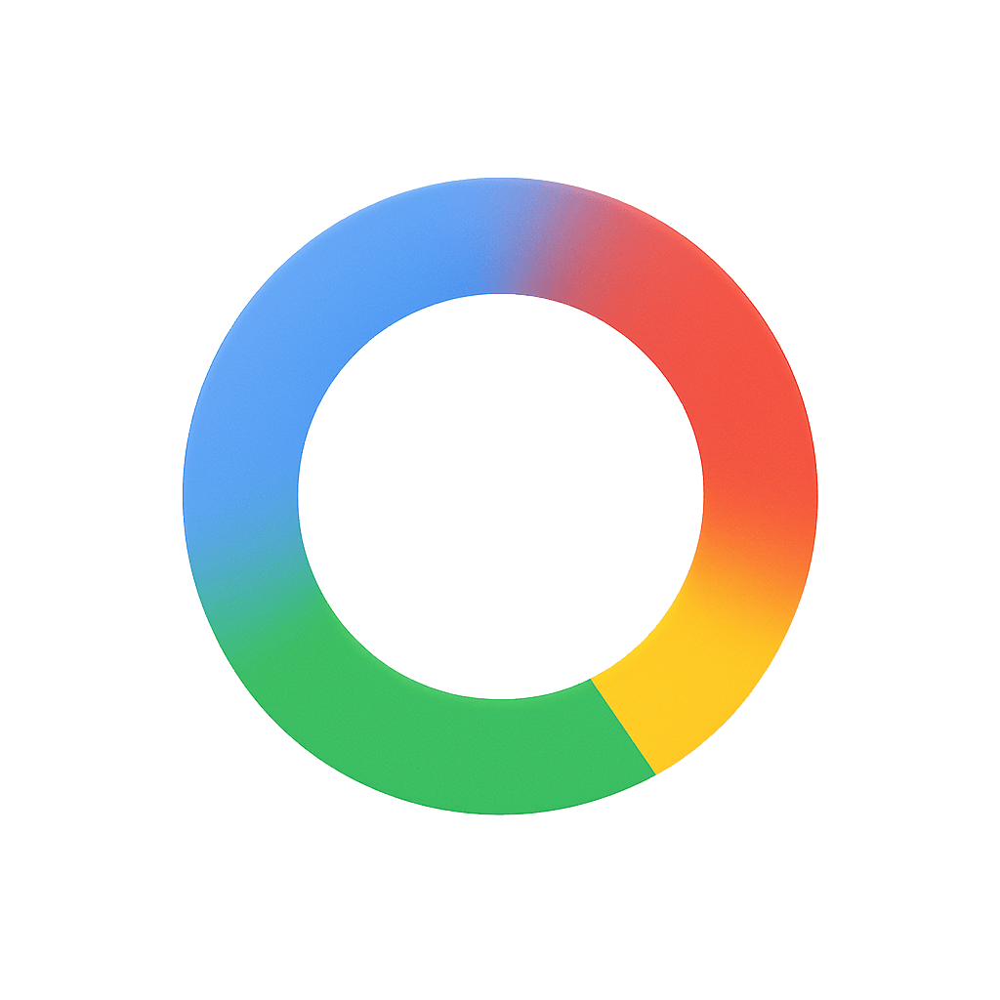

<div align="center">
  
  <h1>CircleToSearch</h1>
  <p><strong>A high-performance, privacy-first Android screen search, offline OCR, translation, and gesture overlay.</strong></p>

  [-3DDC84?logo=android&logoColor=white)](https://developer.android.com/about/versions/10)
  [](https://kotlinlang.org/)
  [](https://www.gnu.org/licenses/gpl-3.0)
  [](https://github.com/GimiRick/CircleToSearch)
  [](#system-architecture--process-topography)
  [](paddleocr)
</div>

---

## Acknowledgements & Lineage

CircleToSearch is built on the shoulders of passionate open-source contributors:

1. **Original Creator — [AKS-Labs](https://github.com/AKS-Labs/CircleToSearch)**:
   Conceived and built the original open-source Circle to Search concept for Android, introducing accessibility-based overlays, gesture triggers, and initial multi-search capabilities.
2. **Hardened Fork Creator — [Art-ovv](https://github.com/Art-ovv/CircleToSearch)**:
   Transformed the project through massive architectural hardening after upstream v0.5. Replaced Tesseract with on-device PaddleOCR, engineered the isolated three-process model, created the SharedMemory binary IPC pipeline, implemented CameraX photo search, and rebuilt gesture coordination.
3. **Current Maintainer & Fork — [Mohammad Faiz (@GimiRick)](https://github.com/GimiRick/CircleToSearch)**:
   Maintains and modernizes this repository. Oversees dependency upgrades (Android Gradle Plugin 9.x, Gradle 9.8+, ONNX Runtime, Kotlin coroutines, ML Kit), build system optimizations, automated testing pipelines, and ongoing platform enhancements.

---

## Overview

**CircleToSearch** brings the seamless "Circle to Search" experience to Android devices running Android 10 or later—without vendor lock-in or mandatory Google Services. With a simple home-button long press, navigation handle gesture, or customized status bar swipe, CircleToSearch freezes the screen, animates Google-style luminous scanning borders, and allows you to circle, highlight, translate, or reverse-search any portion of your display.

Unlike cloud-dependent solutions, **recognition and parsing stay on your device**:

- **Offline OCR**: High-accuracy text recognition running locally via ONNX Runtime and PaddleOCR.
- **On-Device Translation**: Instant screen translation using ML Kit models downloaded directly to the device.
- **Zero Background Tracking**: No analytics, telemetry, or stealth uploads. Your screen content leaves your phone *only* when you explicitly trigger an online reverse-image search.

---

## System Architecture & Process Topography

Android kills background tasks aggressively and restricts Binder transactions to 1MB. To deliver instant response times without running out of memory (OOM) or causing the operating system to drop the default assistant binding, CircleToSearch separates responsibilities across **three isolated OS processes**:

```Architecture
┌────────────────────────────────────────────────────────────────────────┐
│ Main Application Process (:main)                                       │
│ • Jetpack Compose UI (Luminous light fields, bracket handles, sheets)  │
│ • CircleToSearchAccessibilityService (Overlays, Gestures, Touch Zones) │
│ • CaptureSessionCoordinator & BitmapRepository                         │
│ • ScreenTranslator (ML Kit LanguageId + Translation)                   │
│ • QrScanner (ZXing multi-tile pyramid scan)                            │
│ • CameraPhotoProcessor & CameraSearchActivity                          │
└──────────────────────────┬───────────────────────▲─────────────────────┘
                           │                       │
      SharedMemory (Ashmem)│                       │ OcrWireResult IPC
     128MB zero-copy pixel │                       │ Lossless float coords &
      transfer via Binder  │                       │ CTC spans via SharedMemory
                           ▼                       │
┌──────────────────────────────────────────────────┴─────────────────────┐
│ OCR Worker Process (:ocr)                                              │
│ • OcrWorkerService & PaddleOcrEngine                                   │
│ • Native ONNX Runtime & OpenCV Warp Engines                            │
│ • 15s Idle Timer: Terminating PID on idle reclaims native heap to OS   │
└────────────────────────────────────────────────────────────────────────┘

┌────────────────────────────────────────────────────────────────────────┐
│ Voice Interaction Process (:voice)                                     │
│ • CircleToSearchVoiceService                                           │
│ • Ultra-lightweight stub holding OS VOICE_INTERACTION framework binding│
│ • 900ms Watchdog: Prevents Android from dropping assistant role on OOM │
└────────────────────────────────────────────────────────────────────────┘
```

### Why Three Processes?

1. **The `:voice` Process**:
   Android's `VoiceInteractionService` must remain continuously bound to the system framework to intercept assistant invocations. By isolating `CircleToSearchVoiceService` in a minimal `:voice` process that does not load heavy UI or ONNX native libraries, the operating system never terminates the assistant binding during high memory pressure.
2. **The `:ocr` Process**:
   ONNX Runtime and OpenCV allocate large native memory buffers for neural network inference and perspective warps. When running inside the main UI process, native memory is prone to fragmentation and cannot be easily freed by Android's garbage collector. Running OCR in an isolated `:ocr` service allows the app to cleanly shut down and terminate the process (`Process.killProcess()`) after a 15-second idle window, releasing all native heap directly back to Android.
3. **Zero-Copy SharedMemory (Ashmem) IPC**:
   Standard Android Binder IPC transactions crash with `TransactionTooLargeException` if a payload exceeds 1MB. Instead of saving bitmaps to flash storage or parceling raw bytes, CircleToSearch transfers raw frames through anonymous Linux `SharedMemory` handles up to 128MB. Results are passed back through `OcrWireResult`, an efficient custom binary codec that losslessly encodes polygon coordinates and CTC text spans.

---

## Core Features

### 1. Interactive Selection & Luminous Edge Glow

- **Signature Glow**: Recreates the authentic 4-color radial gradient light fields (blue, red, yellow, green) that sweep across screen boundaries upon capture.
- **Smart Touch Slop**: Differentiates between quick taps (which toggle UI control visibility) and intentional drags (which construct selection bounds).
- **Interactive Corner Handles**: Four draggable 64px bracket handles let you fine-tune the selected bounding box, recalculating crops with hardware-clamped coordinates.
- **Reference-Counted Bitmaps**: Strict lifecycle counters ensure cropped bitmaps are never prematurely recycled or leaked during rapid resize gestures.

### 2. Offline Neural OCR (PaddleOCR Engine)

- **High-Precision Models**: Bundled with PP-OCRv4 detection and recognition models optimized via ONNX Runtime.
- **Perspective Unwarping**: OpenCV `warpPerspective` rectifies angled or curved text; tall vertical text ($H/W \ge 1.5$) is automatically rotated 90 degrees counter-clockwise for recognition.
- **Contour Safety Bounds**: Contours are pre-screened to ensure complex backgrounds cannot trigger native memory exhaustion.
- **Dynamic Language Packs**: Download additional language packs (Latin, Chinese/English, Korean, Devanagari) directly within Settings. All downloads are verified with SHA-256 integrity checks, byte-size limits, and path-traversal safeguards before an atomic directory swap.

### 3. Semantic AssistStructure + OCR Synthesis

- Android's native `AssistStructure` provides 100% accurate character strings for standard system views (TextViews, Compose), while OCR is vital for images, videos, and custom WebViews.
- `TextNodeMerger` compares geometric boundaries and semantic text similarity, projecting exact text onto visual bounding boxes while intelligently ignoring generic accessibility containers (e.g. "photo", "image", "media").
- **Word Anchoring**: Using bounded Levenshtein edit distance and intersection-over-union tracking (`findSelectionAnchorMatch`), your active text selection survives smoothly when low-latency coarse OCR is updated by final fine-grained recognition.

### 4. On-Device Screen Translation

- Powered by on-device Google ML Kit language identification and translation.
- **Contextual Language Planning**: Samples screen text (up to 4,000 characters) to identify the dominant language, allowing short fragments (like numbers or isolated words) to inherit the correct source language.
- **Smart Visual Replacement**: Samples outer 14px background margins, checks WCAG 2.1 color contrast, and binary-searches `StaticLayout` font sizes to cleanly replace on-screen foreign text with localized overlays.

### 5. Instant Camera Photo Search

- Launch directly into a dedicated full-screen CameraX viewfinder.
- Tapping the shutter button captures, aspect-fits onto a 2560px canvas with EXIF orientation normalization, letterboxes uniformly, and initiates an immediate visual search.
- The photo remains in the interactive overlay, allowing subsequent OCR copying, barcode scanning, or translations.
- Temporary photos older than 24 hours are automatically purged, while active in-flight captures are guaranteed protection for at least 15 minutes.

### 6. Multi-Symbology Barcode & QR Scanner

- Uses a 3-tier tiled pyramid scanning algorithm (1 full-screen pass + 4 overlapping corner sub-tiles at 65% scale) via ZXing.
- Supports QR Code, Data Matrix, Aztec, PDF417, MaxiCode, Codabar, Code 39/93/128, EAN, UPC, and RSS formats.
- Streams live detections through Kotlin `Flow` so barcodes appear on-screen immediately without waiting for the full image scan to complete.
- Built-in contextual sheet with one-tap actions for URLs, Wi-Fi networks, phone dialing, vCards, and geographic coordinates.

### 7. Multi-Engine Search & Google Lens Fallbacks

- **Google Lens OEM Chain**: Seamlessly delegates visual search via 4 fallbacks (Standalone Google Lens $\rightarrow$ Google QuickSearchBox $\rightarrow$ Google Gallery Lens $\rightarrow$ Action View) with permission-granting `ClipData`.
- **Multi-Search Web Engine**: Non-Google environments can search across Google Images, Bing Visual Search, Yandex Images, and TinEye. Images are staged using temporary, privacy-respecting 1-hour expiration uploads to Litterbox (`litterbox.catbox.moe`) with Catbox fallback.
- **Tab LRU WebView Cache**: Browsing search results maintains state across tabs, evicting oldest WebViews while preserving history bundles and executing complete resource teardowns to eliminate leaks.

### 8. Configurable Overlay Trigger Zones

- Configure multi-segment trigger zones across the status bar or screen edges.
- Supports Double Tap, Triple Tap, Long Press, Swipe Up/Down/Left/Right.
- Trigger actions include CircleToSearch, Google Lens, Flashlight, Screenshot, Split Screen, Recent Apps, and Lock Screen.
- Protected against accidental activations during edge-navigation gestures.

---

## Privacy & Security Blueprint

- **Zero Telemetry**: `ORT_DISABLE_TELEMETRY=1` is explicitly set during application initialization. No analytics or tracking SDKs are bundled.
- **Local-First Execution**: OCR inference, barcode parsing, and translation run entirely on your CPU/NPU.
- **Scoped Network Traffic**: The network is accessed solely when:
  1. You download an optional OCR language pack or ML Kit translation model.
  2. You explicitly trigger a web/reverse-image search.
- **Sandboxed Transient Storage**: Shared screenshots are restricted to internal cache directories under a strict 64MB LRU budget, accompanied by a 24-hour grant grace period for external applications before automatic cleanup.

---

## Build & Installation

### Prerequisites

- **JDK 17**
- **Android SDK 36** (Compile & Target SDK: 36, Min SDK: 29)
- **Git** & **ADB** (Android Debug Bridge)

### 1. Clone & Compile

```bash
git clone https://github.com/GimiRick/CircleToSearch.git
cd CircleToSearch

# Build debug APKs
./gradlew assembleDebug
```

The build generates optimized per-architecture binaries:

- `app/build/outputs/apk/debug/app-arm64-v8a-debug.apk` (Recommended for modern 64-bit devices)
- `app/build/outputs/apk/debug/app-armeabi-v7a-debug.apk` (For legacy 32-bit devices)

### 2. Install on Device

Connect your Android phone via USB debugging:

```bash
adb devices
adb install -r app/build/outputs/apk/debug/app-arm64-v8a-debug.apk
```

### 3. Permissions & Setup

1. Open **CircleToSearch** from your app drawer.
2. Grant the **Accessibility Service** permission (required for screen capture fallback and custom edge gestures).
3. Set CircleToSearch as your device's default **Digital assistant app** in Android Settings (`Settings` $\rightarrow$ `Apps` $\rightarrow$ `Default apps` $\rightarrow$ `Digital assistant app`).
4. (Optional) Add the **CircleToSearch Tile** to your Quick Settings shade.

---

## Testing & Verification

Run the comprehensive unit test suite:

```bash
# Execute local unit tests across app and paddleocr modules
./gradlew testDebugUnitTest

# Run code style and lint analysis
./gradlew lintDebug
```

---

## License & Attribution

This project is licensed under the **GNU General Public License v3.0 (GPL-3.0)**.

- Original codebase created by **[AKS-Labs](https://github.com/AKS-Labs/CircleToSearch)**.
- Hardened fork architecture developed by **[Art-ovv](https://github.com/Art-ovv/CircleToSearch)**.
- Maintained, updated, and extended by **[Mohammad Faiz (@GimiRick)](https://github.com/GimiRick/CircleToSearch)**.

For full license details, see the [LICENSE](LICENSE) file and source header notices.
